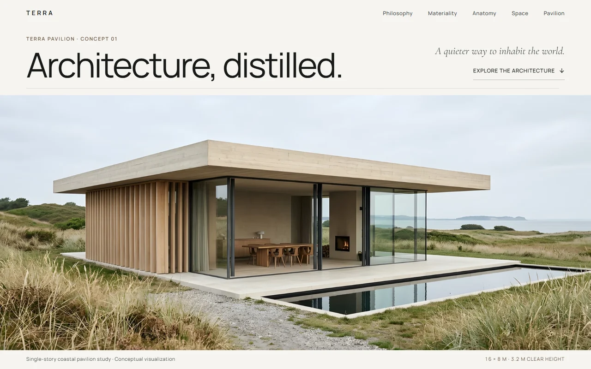
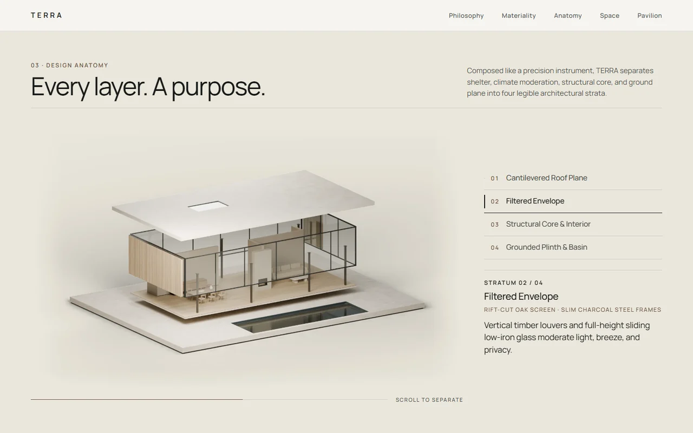
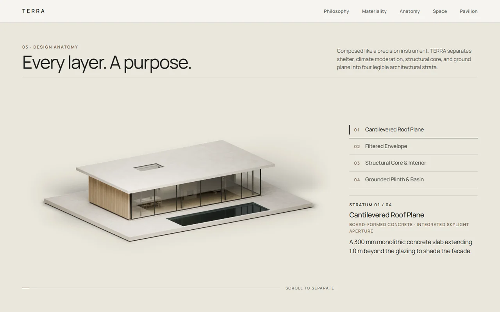
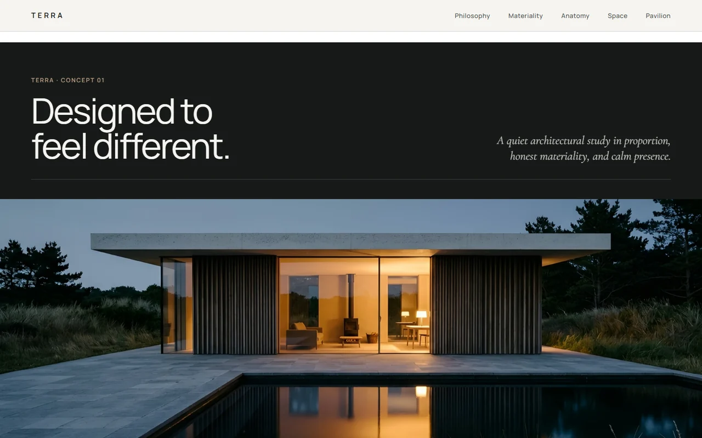
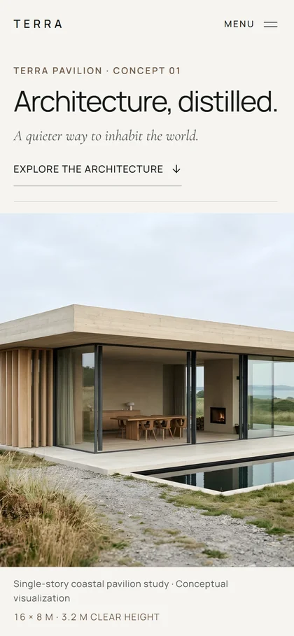
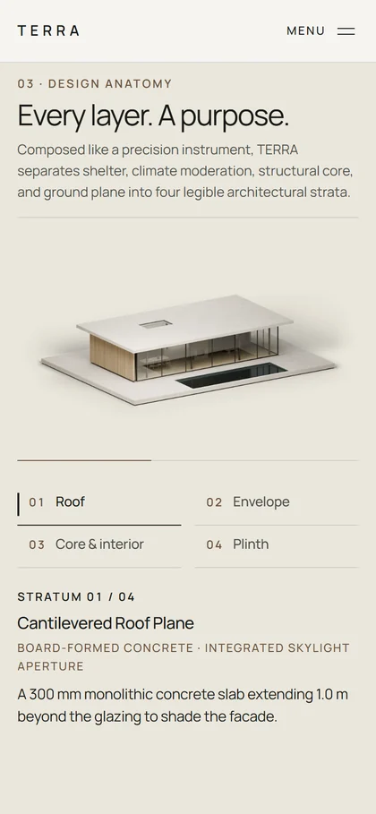

# TERRA

**Architecture, distilled.** — *A quieter way to inhabit the world.*

[](https://github.com/Skiidig/TERRA-Project/releases/tag/v3.0.0)
[](https://terra-project-six.vercel.app/)
[](https://react.dev/)
[](https://www.typescriptlang.org/)
[](https://vite.dev/)

TERRA is an editorial architectural web experience for a conceptual single-story coastal pavilion (`16 × 8 m`, `3.2 m` clear height). It combines quiet monograph typography, responsive super-resolved photography, desktop-only smooth scrolling, and a scroll-controlled exploded architectural assembly rendered in Blender Cycles.

**Live Production**: [https://terra-project-six.vercel.app/](https://terra-project-six.vercel.app/)



---

## Highlights

- **Monumental Editorial Opening** — Full-bleed architectural framing paired with self-hosted `Manrope` display typography, `Cormorant Garamond` italic accents, media-matched AVIF hero preloading (`1920w` / `2752w` desktop and an `800 × 960` art-directed mobile portrait crop), and restrained scroll handoff.
- **Unified Design Anatomy** — A sticky architectural plate keeping the section header, `16:10` Blender Cycles exploded pavilion, progress track, and WAI-ARIA 4-layer inspector visually unified across a compact scroll runway (`950 px` desktop, `780 px` tablet, `600 px` mobile).
- **Tactile Materiality & Spatial Flow** — Asymmetric philosophy dimension ledger, staggered material studies (board-formed concrete, rift-cut oak, low-iron glass) with subtle desktop counter-drift, full-bleed interior parallax, and a charcoal twilight closing (`#171A18`) with an adaptive dark sticky header.
- **Refined Input-Aware Motion** — Desktop-only `lenis` smooth wheel interpolation (`lerp: 0.14`) synchronized to `gsap.ticker` and `ScrollTrigger`, while preserving 100% native scrolling on mobile, tablet, touch devices, and reduced-motion environments.

---

## Visual Tour

| Unified Design Anatomy (Exploded) | Spatial Experience |
| :---: | :---: |
|  |  |

| Twilight Closing | Mobile Hero & Design Anatomy (`390 × 844`) |
| :---: | :---: |
|  |   |

---

## Technical Architecture

- **Frontend Core**: React 19, TypeScript 5.9, Vite 7, and plain CSS with custom properties (`src/style.css`, `src/content/v2Content.ts`).
- **Motion & Scroll**: GSAP 3 (`ScrollTrigger` inside scoped `gsap.matchMedia()`), desktop-only `lenis@1.3.28` (`src/lib/smoothScroll.ts`, gated to `(hover: hover) and (pointer: fine) and (min-width: 64rem) and (prefers-reduced-motion: no-preference)`), and frame-rate-independent local `requestAnimationFrame` damping (`tau = 65–115 ms`) for Design Anatomy.
- **Canvas Sequence Engine (`src/anatomy/`)**: Zero runtime WebGL in the production bundle. `framePlayer.ts` renders transparent WebP frames onto a 2D `<canvas>` using `createImageBitmap` composited over `#EBE7DC` with a `7.5%` perimeter feather.
- **Zero External Font Requests**: Self-hosted Latin WOFF2 files in `public/fonts/`.

---

## Blender Rendering & Asset Delivery Pipeline

The Design Anatomy assembly is pre-rendered from bespoke original Blender geometry in **Blender 5.3.0** (Cycles OptiX, 96 adaptive samples, OpenImageDenoise, studio shadow catcher) and delivered as versioned responsive WebP sequences under `public/anatomy-sequence/v2-004b/`:

| Variant | Resolution | Frames | Total Transfer | Encoding | Viewport Selection |
| --- | --- | ---: | ---: | --- | --- |
| Desktop | `1600 × 1000` | `96` | `7.68 MiB` | WebP `q86` | `>= 768 px` non-compact viewports |
| Mobile | `896 × 560` | `48` | `1.99 MiB` | WebP `q84` | `< 768 px` or compact touch landscape |
| Manifest | — | `144` entries | `13.5 kB` | JSON | `/anatomy-sequence/v2-004b/manifest.json` |

---

## Performance Engineering

- **Zero Sequence Preload at Hero**: Intent-gated arming (`scrollY >= 40`, `/#anatomy` deep-link, or section intersection) defers poster, manifest, and sequence fetches until the user scrolls toward Design Anatomy (`0 B` sequence transfer on initial load).
- **Decoupled Fetch & Decode Queues**: Coarse-to-fine idle prefetching (strides `8 → 4 → 2 → 1`) populates a bounded compressed `Blob` LRU (`9 MiB` desktop / `4 MiB` mobile) across `4` desktop / `2` mobile HTTP lanes, while `ImageBitmap` decoding (`2` lanes) stays focused on active targets.
- **Strict Bounded GPU/RGBA Memory**: Pre-decode eviction with explicit `bitmap.close()` caps live decoded frames at `8` desktop (`48.83 MiB` peak RGBA) and `10` mobile (`19.14 MiB` peak RGBA).
- **Versioned Immutable Caching**: `vercel.json` serves `/anatomy-sequence/v2-004b/*` with `Cache-Control: public, max-age=31536000, immutable`, while keeping `/images/*` (`max-age=3600, stale-while-revalidate=86400`) and `/fonts/*` (`max-age=86400, stale-while-revalidate=604800`) safely revalidatable.
- **Measured Results** *(lab & live HTTPS telemetry, not real-user field CrUX data)*:
  - **Public Production Cold Load** (`https://terra-project-six.vercel.app/`, headless Edge CDP, `1440 × 900`, clean cache): `LCP 1,676 ms`, `CLS 0.0018`, `0` console/page errors, `0` failed requests, `1` Hero AVIF request (`hero-v3c-1920w.avif`), `0` initial Anatomy requests.
  - **Controlled Throttled Scrub** (`15 Mbps / 65 ms` Edge CDP, `1440 × 900`): Cold `p95HoldMs 83.6 ms` / warm `38.9 ms`; live production warm repeat served `44` of `76` fetched frames directly from browser disk cache (`+77.6%` canvas draw density over cold).

---

## Local Development

Requires **Node.js 26 LTS** (`>=26 <27`) and **npm 11** (`>=11 <12`).

```bash
git clone https://github.com/Skiidig/TERRA-Project.git
cd TERRA-Project
npm ci
npm run dev -- --host localhost
```

### Verification & Production Build

```bash
npm run typecheck
npm run lint
npm run build
npm run preview -- --host localhost
```

Static production assets are emitted to `dist/`.

---

## Evolution

- **V1 (`7bd2201`)** — Initial editorial architectural monograph powered by a real-time procedural Three.js / React Three Fiber WebGL 2 diorama.
- **V2 (`bead7ef`)** — Replaced runtime WebGL with pre-rendered Blender Cycles exploded pavilion sequences on a bounded-memory 2D canvas player and responsive WebP photography.
- **V3.0.0 (`6c486cd`, current production)** — Elevated the full-page editorial composition with a monumental Hero, selectively super-resolved AVIF/WebP photography, desktop-only Lenis smooth scroll, a unified sticky Design Anatomy plate, decoupled cold-scroll prefetching, and versioned immutable caching.

---

## Accessibility

- Semantic landmarks, `Skip to content` link, and focus-visible keyboard navigation across header links, mobile drawer (`Escape` to close), and footer controls.
- Full WAI-ARIA `tablist` keyboard control (`Arrow`, `Home`, `End`) on the Design Anatomy inspector with interruptible scroll-to-layer navigation.
- `prefers-reduced-motion: reduce` disables Lenis smooth scrolling, parallax, and Anatomy sequence downloads, rendering the static assembled pavilion poster with full manual layer inspection.
- `Save-Data` and `2g` connections automatically disable background frame prefetching and narrow active lookahead.

---

## Conceptual Imagery & Attribution

- **AI-Assisted Conceptual Photography**: Editorial photographs in Hero, Philosophy, Materiality, Spatial Experience, and Closing (`public/images/`) are **AI-generated conceptual architectural visualizations** and do not represent a built project. Hero, Spatial, Closing, and Philosophy plates were selectively super-resolved from original masters using portable `realesrgan-ncnn-vulkan` (`realesrgan-x4plus`, with a conservative `60/40` blend on editorial sections) and encoded as responsive AVIF primary / WebP fallback assets.
- **Original 3D Architectural Model**: The Design Anatomy pavilion sequence (`public/anatomy-sequence/v2-004b/`) was modeled and rendered from original Blender geometry.
- **Typography**:
  - **Manrope** — SIL Open Font License, Version 1.1 ([OFL-Manrope.txt](public/fonts/OFL-Manrope.txt))
  - **Cormorant Garamond** — SIL Open Font License, Version 1.1 ([OFL-Cormorant-Garamond.txt](public/fonts/OFL-Cormorant-Garamond.txt))

---

## Documentation

- [Technical Architecture](docs/ARCHITECTURE.md)
- [Project Roadmap](docs/ROADMAP.md)
- [Engineering Handoff Log](docs/HANDOFF.md)
